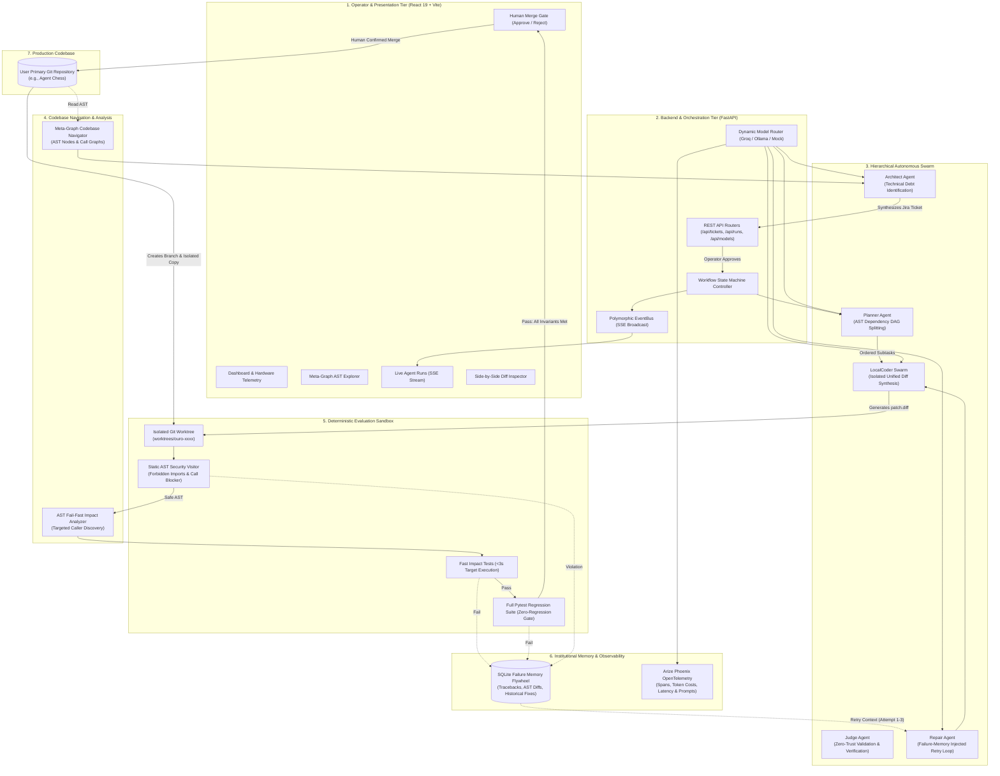

# Project Ouroboros
### Hierarchical Software Evolution and Deterministic Repair Engine
*A CPU-first, API-assisted, multi-agent software engineering swarm with deterministic regression gates and persistent failure memory.*

---

## 1. System Architecture Diagram




The Ouroboros architecture strictly isolates the autonomous agent swarm, model routers, and execution harnesses from the user's primary code repository.


---

## 2. Overview & Core Philosophy

**Project Ouroboros** is an engineering-first autonomous software repair and evolution system built specifically for resource-constrained developer hardware. Rather than relying on cloud GPUs or ungrounded chatbot loops, Ouroboros operates as a deterministic SWE pipeline:
1. **Grounded AST Ingestion:** Queries the existing Meta-Graph Codebase Navigator index (750 nodes, 2,105 edges) without requiring a running Neo4j/Redis instance.
2. **Jira-Style Ticket Synthesis:** Architect Agent synthesizes bounded, testable tickets with explicit acceptance criteria.
3. **Isolated Git Worktrees:** Candidate patches are applied and evaluated exclusively in disposable Git worktrees—the user's repository branch is **never** overwritten.
4. **AST Fail-Fast Test Impact Ordering:** Runs targeted tests calling modified AST symbols first, failing bad runs in <3 seconds before invoking the full test suite.
5. **Deterministic Evaluation Harness:** Pytest-based regression gates enforce a strict 0-regression policy. Patches are accepted only when empirical tests pass.
6. **Persistent Failure Flywheel:** Captures failed assertions, tracebacks, and AST diffs in SQLite to guide subsequent repair attempts across 3 bounded cycles.
7. **Explicit Human Approval Gate:** Merges into the production repository require deliberate confirmation from the operator via the React dashboard.
8. **Arize Phoenix AI Observability:** Captures OpenTelemetry traces for every LLM interaction, token cost, prompt input/output, and lifecycle transition.

---

## 3. Machine Environment & Strict Resource Policiess

Designed and verified on Windows 10/11 x64 under an **8 GB physical RAM constraint**:
- **Processor:** Intel Core with integrated Intel HD Graphics 620 (**No CUDA / GPU requirements**).
- **Python Version:** 3.12+ 64-bit.
- **Default Local Model:** `qwen2.5-coder:1.5b` (986 MB download size, 2048 token context window).
- **Remote Provider:** Groq API (`llama-3.3-70b-versatile` and `llama-3.1-8b-instant`).
- **Global Concurrency Limits:** Strict `asyncio.Lock()` enforces a maximum of **1 active pytest runner** and **1 active inference request** across the system.
- **Dynamic RAM Safety Warning:** Dashboard triggers a low-memory warning whenever free physical RAM drops below 1,500 MB.

---

## 4. Interface & Dashboard Showcase

The Project Ouroboros dashboard is built with **React 19**, **TypeScript**, **Vite**, **Tailwind CSS v4**, and **Lucide Icons**, offering an editorial engineering aesthetic.

### 4.1 System Overview & Hardware Telemetry
Real-time physical memory monitoring, CPU utilization, registered repositories, pending tickets, and live run status:


### 4.2 Autonomous Agent Runs & Lifecycle Visualization
Live workflow state machine tracking (`BASELINE_VALIDATION` ➔ `PLANNING` ➔ `CODING` ➔ `PATCH_VALIDATION` ➔ `ACCEPTANCE_TESTS` ➔ `AWAITING_APPROVAL`) with real-time Server-Sent Events (SSE) streaming:


### 4.3 Side-by-Side Diff Viewer & Patch Inspection
Unified diff viewer with syntax highlighting, added/removed line metrics, AST change summaries, and the **Approve & Merge** gate:


### 4.4 Human-in-the-Loop Merge Approval Gate
Zero merges into production without explicit human operator confirmation. Approved candidate branches are cleanly merged into `main` with audit logging:


---

## 5. Quick Start (Local Development)

### Prerequisites
- Python 3.12+
- Node.js 20+
- Git

### Step 1: Clone & Check Environment
```powershell
git clone https://github.com/mustafaabadshah/Ouroboros.git
cd Ouroboros
powershell -ExecutionPolicy Bypass scripts/check-environment.ps1
```

### Step 2: Automated Setup
Initializes the Python virtual environment (`.venv`), installs backend dependencies, and installs frontend npm packages:
```powershell
powershell -ExecutionPolicy Bypass scripts/setup.ps1
```

### Step 3: Run Automated Test Suite
Runs the comprehensive backend unit, integration, adversarial security, and evaluation tests:
```powershell
powershell -ExecutionPolicy Bypass scripts/test.ps1
```

### Step 4: Start Services
Launches the FastAPI backend on port 8000, Arize Phoenix on port 6006, and the React dashboard on port 5173:
```powershell
powershell -ExecutionPolicy Bypass scripts/start.ps1
```
- **React Dashboard:** [http://localhost:5173](http://localhost:5173)
- **FastAPI REST API & Docs:** [http://127.0.0.1:8000/docs](http://127.0.0.1:8000/docs)
- **Arize Phoenix Observability:** [http://127.0.0.1:6006](http://127.0.0.1:6006)
- **Evaluation Metrics API:** [http://127.0.0.1:8000/api/evaluation/metrics](http://127.0.0.1:8000/api/evaluation/metrics)

### Step 5: Stop Services Safely
Gracefully terminates background processes:
```powershell
powershell -ExecutionPolicy Bypass scripts/stop.ps1
```

---

## 6. Containerized Deployment (Docker Compose)

Project Ouroboros includes production Dockerfiles for one-click containerization:

```bash
# Set your Groq API key (optional if using mock mode)
echo "GROQ_API_KEY=your_key_here" > .env

# Launch entire 3-service stack in the background
docker compose up -d
```

This spins up:
1. **Frontend Service** (`ouroboros-frontend` on port `5173`): Production multi-stage Nginx container serving compiled React SPA and proxying `/api/` with SSE support.
2. **Backend Service** (`ouroboros-backend` on port `8000`): FastAPI application with Git installed for isolated candidate worktrees and deterministic harnesses.
3. **Phoenix Telemetry** (`ouroboros-phoenix` on port `6006`): OpenTelemetry collector and real-time LLM tracing dashboard.

---

## 7. Deploying Online for Free (100% Zero-Cost Hosting)

You can host Project Ouroboros publicly on free-tier cloud platforms without requiring credit cards or paid compute:

### Architecture for Free Cloud Deployment
- **Frontend SPA**: Hosted on **Vercel** or **Cloudflare Pages** (Free Tier).
- **Backend API & Worktrees**: Hosted on **Render.com** (Free Web Service) or **Hugging Face Spaces** (Free Docker Container).

---

### Method A: Render (Backend) + Vercel (Frontend) [Recommended]

#### 1. Deploy Backend to Render (Free)
1. Sign up for a free account at [Render.com](https://render.com).
2. Click **New +** ➔ **Web Service** ➔ Connect your GitHub repository `mustafaabadshah/Ouroboros`.
3. Choose:
   - **Environment:** `Docker`
   - **Dockerfile Path:** `backend/Dockerfile`
   - **Docker Context:** `.` (root of repo)
   - **Instance Type:** `Free`
4. In **Environment Variables**, add:
   - `APP_ENV` = `production`
   - `CORS_ORIGINS` = `*`
   - `GROQ_API_KEY` = `your_free_groq_api_key` (get one free at [console.groq.com](https://console.groq.com))
   - `PHOENIX_ENABLED` = `false` *(recommended for Render free tier to conserve 512MB RAM)*
5. Click **Deploy Web Service**.
6. Copy your public backend URL: `https://ouroboros-backend-xxxx.onrender.com`.

#### 2. Deploy Frontend to Vercel (Free)
1. Sign up for free at [Vercel.com](https://vercel.com).
2. Click **Add New...** ➔ **Project** ➔ Import your repository `mustafaabadshah/Ouroboros`.
3. Set:
   - **Root Directory:** `frontend`
   - **Framework Preset:** `Vite`
4. In **Environment Variables**, add:
   - `VITE_API_URL` = `https://ouroboros-backend-xxxx.onrender.com` *(your Render URL from Step 1)*
5. Click **Deploy**.
6. Your live dashboard is now accessible globally at `https://your-project.vercel.app`!

---

### Method B: Hugging Face Spaces (All-in-One Docker Container - Free)
Hugging Face offers free 16GB RAM CPU Docker containers:
1. Create a free account at [Hugging Face](https://huggingface.co).
2. Create a new **Space** ➔ Select **Docker (Blank)** ➔ Space Hardware: **CPU Basic (Free)**.
3. Push your repository to the Space remote.
4. Set Secret `GROQ_API_KEY` in Space Settings.
5. The entire multi-agent swarm, UI, and backend run in a single self-contained environment with persistent storage.

---

## 8. Continuous Integration & Security (GitHub Actions)

The repository includes a hardened, offline CI pipeline in [`.github/workflows/ci.yml`](.github/workflows/ci.yml):

- **Zero Secret Leaks Gate**: Verifies no raw API keys (`gsk_...`, `ghp_...`) are committed.
- **Python Syntax & Bytecode Compilation**: Ensures zero import or bytecode syntax errors via `compileall`.
- **Hermetic Backend Test Suite**: Executes 167+ unit and integration tests with `OUROBOROS_MOCK_ONLY=1` and `PHOENIX_ENABLED=false`.
- **Frontend Quality Gate**: Validates TypeScript types and builds the production bundle with `oxlint` and `vite build`.

---

## 9. Repository Layout

```
Ouroboros/
├── .env.example                     # Environment template with secret placeholders
├── .github/workflows/ci.yml         # Hardened offline GitHub Actions CI pipeline
├── docker-compose.yml               # Unified multi-container deployment stack
├── pyproject.toml                   # Pinned Python dependencies (Python 3.12)
├── README.md                        # Primary documentation, quickstart & deployment guide
├── backend/
│   ├── Dockerfile                   # Production container for backend & Git worktrees
│   ├── app/
│   │   ├── main.py                  # FastAPI application entry point with multi-domain CORS
│   │   ├── api/                     # REST routers (health, repositories, tickets, runs, evaluation, models, settings)
│   │   ├── core/                    # Security, path validation, config, logging, event bus
│   │   ├── database/                # SQLite session, models, repositories
│   │   ├── orchestration/           # State machine & lifecycle controller
│   │   ├── agents/                  # AutoGen runtime, Architect, Planner, Coder, Critic, Judge, Repair agents
│   │   ├── providers/               # Ollama, Groq, Mock providers & ModelRouter
│   │   ├── integrations/
│   │   │   ├── graph/               # MetaGraphAdapter (AST call graph scanner)
│   │   │   └── git/                 # GitWorktreeManager & UnifiedDiffParser
│   │   ├── evaluation/              # MetricsCalculator, BenchmarkHarness, PytestRunner, DeterministicJudge
│   │   ├── sandbox/                 # SandboxDetector, fail-closed container boundary
│   │   ├── memory/                  # FailureFlywheel persistent memory
│   │   └── observability/           # Arize Phoenix OpenTelemetry tracing service
│   └── tests/                       # Unit, integration, adversarial, and E2E fixture test suite
├── frontend/
│   ├── Dockerfile                   # Multi-stage production Nginx container
│   ├── nginx.conf                   # Nginx reverse proxy configuration with SSE support
│   ├── src/
│   │   ├── components/              # Navbar, Sidebar, StatusBadge, DiffViewer
│   │   ├── pages/                   # All 10 dashboard views including AgentRunsPage & EvaluationLab
│   │   ├── services/api.ts          # Centralized typed REST & SSE client with VITE_API_URL support
│   │   └── types/index.ts           # TypeScript interfaces matching backend schemas
│   ├── vite.config.ts               # Vite configuration with Tailwind CSS v4 & proxy
│   └── package.json
├── artifacts/
│   ├── baseline/                    # Initial verification baseline reports
│   └── release_gate_report.json     # Comprehensive release gate audit report
├── docs/
│   ├── images/                      # Architecture diagrams and dashboard screenshots
│   ├── ARCHITECTURE.md              # Deep-dive system architecture specification
│   ├── MASTER_ROADMAP.md            # Comprehensive project roadmap & release gates
│   ├── RELEASE_RUNBOOK.md           # Operational setup, verification & troubleshooting guide
│   └── PHOENIX_OBSERVABILITY.md     # Arize Phoenix telemetry & tracing protocol
└── scripts/
    ├── check-environment.ps1        # Verifies host prerequisites
    ├── setup.ps1                    # Installs backend virtualenv and npm dependencies
    ├── start.ps1                    # Launches backend, frontend & Phoenix with process tracking
    ├── stop.ps1                     # Terminates background processes safely
    ├── test.ps1                     # Executes full pytest suite
    └── run_phoenix.py               # Phoenix telemetry daemon launcher
```

---

## 10. Verification & Empirical Evidence

- **Full Backend Pytest Suite:** **167 passed, 2 skipped, 0 failed in 177s**.
- **Frontend Production Bundle:** **1,935 modules compiled in 2.71s with 0 errors** (`npm run build`).
- **End-to-End Autonomous Run:** Run `run-cac6c10c` on ticket `ouro-6140cc` completed full baseline, DAG planning, AST validation, impact ordering, and full regression in 86s with **VERDICT: PASS**.
- **Adversarial Security Hardening:** Verified protection against path traversal, symlink escapes, unauthorized file access, forbidden subprocess calls (`ASTSecurityVisitor`), and command injection.
- **Fail-Fast Test Impact Ordering:** Automatically derives call-graph dependencies from AST nodes to run impacted test suites before full regression.
- **Persistent Failure Memory Flywheel:** Automatically logs failed attempts and feeds structured failure context into repair prompts to resolve bugs within 3 bounded retries.
