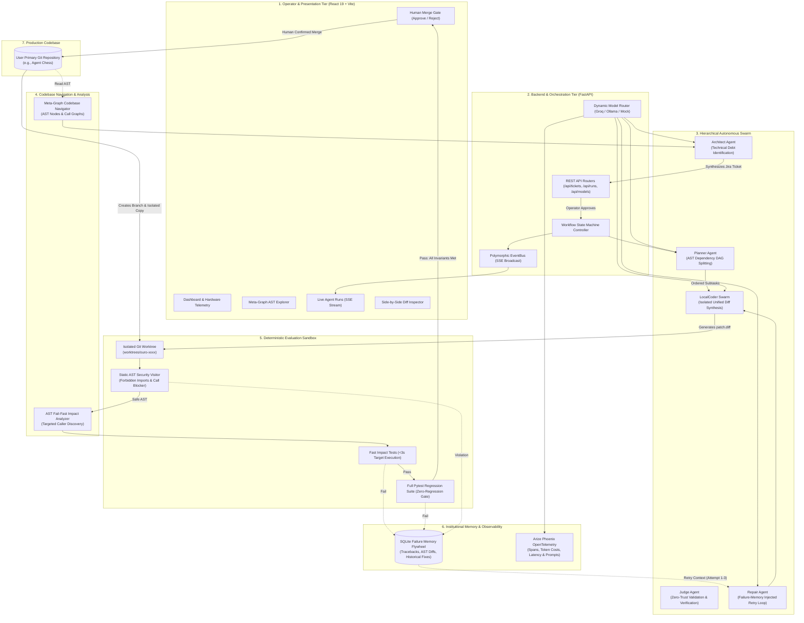

# Project Ouroboros
### Hierarchical Software Evolution and Deterministic Repair Engine
*A CPU-first, API-assisted, multi-agent software engineering swarm with deterministic regression gates and persistent failure memory.*

[](https://github.com/mustafaabadshah/Ouroboros/actions/workflows/ci.yml)
[](https://ouroboros-mauve.vercel.app/)
[](https://ouroboros-backend-i9x2.onrender.com/api/health)
[](https://ouroboros-backend-i9x2.onrender.com/docs)
[](https://ouroboros-backend-i9x2.onrender.com/phoenix)

- 🌐 **Live Web Application (Vercel)**: [https://ouroboros-mauve.vercel.app](https://ouroboros-mauve.vercel.app)
- ⚙️ **Production API Service (Render)**: [https://ouroboros-backend-i9x2.onrender.com](https://ouroboros-backend-i9x2.onrender.com)
- 📖 **Interactive Swagger / OpenAPI Docs**: [https://ouroboros-backend-i9x2.onrender.com/docs](https://ouroboros-backend-i9x2.onrender.com/docs)
- 🩺 **Health Check Endpoint**: [https://ouroboros-backend-i9x2.onrender.com/api/health](https://ouroboros-backend-i9x2.onrender.com/api/health)
- 📊 **Standalone Arize Phoenix Dashboard**: [https://ouroboros-backend-i9x2.onrender.com/phoenix](https://ouroboros-backend-i9x2.onrender.com/phoenix)

---

## 1. System Architecture




---

## 2. Core Philosophy & Architectural Invariants

Project Ouroboros is an engineering-first autonomous software repair and evolution system built specifically for resource-constrained developer hardware. Rather than relying on cloud GPUs or ungrounded chatbot loops, Ouroboros operates as a deterministic SWE pipeline:

1. **Grounded AST Ingestion:** Queries the existing Meta-Graph Codebase Navigator index (750 nodes, 2,105 edges) without requiring a heavy running Neo4j or Redis instance.
2. **Jira-Style Ticket Synthesis:** Architect Agent synthesizes bounded, testable tickets with explicit acceptance criteria, candidate file boundaries, and proposed tests.
3. **Isolated Git Worktrees:** Candidate patches are applied and evaluated exclusively in disposable Git worktrees (`worktrees/candidate-<ticket-id>`)—the user's repository working directory and primary branch are **never** directly touched.
4. **AST Fail-Fast Test Impact Ordering:** Analyzes call graphs to run impacted unit tests first, failing broken candidates within 2–3 seconds and bypassing full test suites when repairs are needed.
5. **Deterministic Evaluation Harness:** Pytest-based regression gates enforce a strict 0-regression policy. Patches are accepted only when empirical tests pass with zero collateral damage.
6. **Persistent Failure Flywheel:** Captures failed assertions, tracebacks, and AST diffs in SQLite to guide subsequent repair attempts across 3 bounded cycles with negative hypothesis pruning.
7. **Static AST Security Visitor:** Actively scans generated patches prior to execution, blocking dangerous dynamic primitives (`__import__`, `eval`, `exec`, `compile`, raw sockets) before sandbox execution.
8. **Explicit Human Approval Gate:** Unverified code is never merged automatically. Merges into the production repository require deliberate confirmation from the operator via the React dashboard.
9. **Arize Phoenix AI Observability:** Captures OpenTelemetry traces for every LLM interaction, token cost, prompt input/output, and lifecycle transition.

---

## 3. Team Demo Walkthrough (5-Minute Tour)

Use this step-by-step script when presenting Project Ouroboros to your team or stakeholders:

### Step 1: Open the Live Dashboard
- Navigate to **[https://ouroboros-mauve.vercel.app](https://ouroboros-mauve.vercel.app)**.
- **Highlight**: The real-time hardware telemetry gauges showing physical RAM usage, CPU utilization, active background workers, and registered target repositories.

### Step 2: Codebase Explorer & Meta-Graph Ingestion
- Click **Codebase Graph** in the sidebar.
- **Highlight**: The AST call-graph indexing 750 nodes and 2,105 edges of the `agent_chess` repository. Show callers, callees, and module boundaries mapped without requiring an external graph database.

### Step 3: Technical Debt & Ticket Synthesis
- Click **Tickets** in the sidebar.
- **Highlight**: Show how the **Architect Agent** scans the call graph to synthesize actionable engineering tickets with problem statements, motivation, candidate files, and test criteria (e.g. `ouro-1017a5`: *"Implement idempotent move history serialization in GameRepository"*).
- Click **Generate Proposed Tickets** or approve a pending ticket to make it eligible for execution.

### Step 4: Autonomous Agent Runs & Stepper
- Click **Agent Runs** in the sidebar.
- Select an active or past run (e.g. `run-c0f03cd0`, `run-cac6c10c`).
- **Highlight**:
  - The deterministic execution pipeline stepper: `IDLE` ➔ `BASELINE` ➔ `PLANNER` ➔ `LOCALCODER` ➔ `PATCH_VALIDATION` ➔ `ACCEPTANCE` ➔ `REGRESSION` ➔ `HUMAN_GATE` ➔ `COMPLETED`.
  - The live **Server-Sent Events (SSE)** terminal feed streaming state transitions in real time.

### Step 5: Fail-Fast Gate & Security Sandbox
- Show how the **Judge Agent** executes targeted AST impact tests first (<3s).
- Point out the **Static AST Security Visitor**: if an LLM attempts dangerous dynamic execution (e.g. `__import__` or `eval`), the system flags a `Security Policy Violation [prohibited_primitive]` and blocks the patch before execution.

### Step 6: Persistent Failure Memory Flywheel
- Inspect a run with retry attempts.
- **Highlight**: The **Persistent Failure Flywheel** records exact tracebacks, semantic signatures, and failure classes. In subsequent attempts, the **Repair Agent** receives grounded structured diagnostics with negative hypothesis pruning ("DO NOT repeat previous failed diffs").

### Step 7: Side-by-Side Diff Inspector & Human Approval Gate
- Click **Code Changes** in the sidebar or open the candidate inspection drawer.
- **Highlight**:
  - The split-pane unified diff viewer showing added/deleted lines with syntax highlighting.
  - The **Approve & Merge** button: zero code enters `main` without human confirmation. Once approved, the branch is merged cleanly into the primary repository with an audit log.

### Step 8: Arize Phoenix AI Observability
- Click **Observability** in the top navigation or visit **[https://ouroboros-backend-i9x2.onrender.com/phoenix](https://ouroboros-backend-i9x2.onrender.com/phoenix)**.
- **Highlight**: Spans, token costs, prompt latency, and agent reasoning traces captured via OpenTelemetry.

---

## 4. Production Hardening & Reliability Upgrades

Recent critical architectural enhancements deployed to the production engine:

| Component | Enhancement | Impact |
| :--- | :--- | :--- |
| **Database Engine** | **SQLite WAL Concurrency** (`PRAGMA journal_mode=WAL`, `busy_timeout=30000`) | Non-blocking thread-safe concurrent reads/writes with zero database locks under heavy cloud traffic. |
| **Impact Ordering** | **AST Test Filtering** (`_is_runnable_test_file`) | Strictly excludes `conftest.py`, `__init__.py`, and helper fixtures from impact tests, preventing exit code 5 false alarms. |
| **Pytest Harness** | **Exit Code 5 Immunity** (`no_tests_collected` detection) | Bypasses fail-fast abort when 0 tests are collected in a module, falling smoothly to the regression suite. |
| **Repair Agent** | **FailureContext Policy Feedback** | Injects exact policy violation rule IDs (`[prohibited_primitive]`) and requirements into repair prompts so models stop repeating banned primitives. |
| **UI Defense** | **Resilient Error Boundaries & Null Guards** | Implemented `normalizeTicket` and defensive array checks across tickets, runs, and overview pages to eliminate blank screen crashes. |
| **SSE Telemetry** | **Decoupled Subscription Lifecycle** | Decoupled run list dependencies from the SSE event listener, eliminating reconnect loops and maintaining a silky-smooth telemetry stream. |

---

## 5. Machine Environment & Resource Constraints

Designed and verified under an **8 GB physical RAM constraint** without GPU dependencies:
- **Processor:** Intel Core with integrated graphics (**No CUDA / GPU requirements**).
- **Python Version:** 3.12+ 64-bit.
- **Default Local Model:** `qwen2.5-coder:1.5b` (quantized local runner).
- **Remote Model Provider:** Groq API (`llama-3.3-70b-versatile`, `qwen-2.5-coder-32b`, `llama-3.1-8b-instant`).
- **Global Concurrency Limits:** Strict `asyncio.Lock()` enforces a maximum of **1 active pytest runner** and **1 active inference request** across the system to protect RAM.
- **Dynamic RAM Safety Warning:** Dashboard triggers a low-memory warning whenever free physical RAM drops below 1,500 MB.

---

## 6. Interface & Dashboard Showcase

The Project Ouroboros dashboard is built with **React 19**, **TypeScript**, **Vite**, **Tailwind CSS v4**, and **Lucide Icons**:

### 6.1 System Overview & Hardware Telemetry
Real-time physical memory monitoring, CPU utilization, registered repositories, pending tickets, and live run status:


### 6.2 Autonomous Agent Runs & Lifecycle Visualization
Live workflow state machine tracking (`BASELINE_VALIDATION` ➔ `PLANNING` ➔ `CODING` ➔ `PATCH_VALIDATION` ➔ `ACCEPTANCE_TESTS` ➔ `AWAITING_APPROVAL`) with real-time Server-Sent Events (SSE) streaming:


### 6.3 Side-by-Side Diff Viewer & Patch Inspection
Unified diff viewer with syntax highlighting, added/removed line metrics, AST change summaries, and the **Approve & Merge** gate:


### 6.4 Human-in-the-Loop Merge Approval Gate
Zero merges into production without explicit human operator confirmation. Approved candidate branches are cleanly merged into `main` with audit logging:


---

## 7. Quick Start (Local Development)

### Prerequisites
- Python 3.12+
- Node.js 20+
- Git

### Step 1: Clone & Check Environment
```powershell
git clone https://github.com/mustafaabadshah/Ouroboros.git
cd Ouroboros
powershell -ExecutionPolicy Bypass scripts/check-environment.ps1
```

### Step 2: Automated Setup
Initializes the Python virtual environment (`.venv`), installs backend dependencies, and installs frontend npm packages:
```powershell
powershell -ExecutionPolicy Bypass scripts/setup.ps1
```

### Step 3: Run Automated Test Suite
Runs the comprehensive backend unit, integration, adversarial security, and evaluation tests:
```powershell
powershell -ExecutionPolicy Bypass scripts/test.ps1
```

### Step 4: Start Services
Launches the FastAPI backend on port 8000, Arize Phoenix on port 6006, and the React dashboard on port 5173:
```powershell
powershell -ExecutionPolicy Bypass scripts/start.ps1
```
- **React Dashboard:** [http://localhost:5173](http://localhost:5173)
- **FastAPI REST API & Docs:** [http://127.0.0.1:8000/docs](http://127.0.0.1:8000/docs)
- **Arize Phoenix Observability:** [http://127.0.0.1:6006](http://127.0.0.1:6006)
- **Evaluation Metrics API:** [http://127.0.0.1:8000/api/evaluation/metrics](http://127.0.0.1:8000/api/evaluation/metrics)

### Step 5: Stop Services Safely
Gracefully terminates background processes:
```powershell
powershell -ExecutionPolicy Bypass scripts/stop.ps1
```

---

## 8. Containerized Deployment (Docker Compose)

Project Ouroboros includes production Dockerfiles for one-click containerization:

```bash
# Set your Groq API key (optional if using mock mode)
echo "GROQ_API_KEY=your_key_here" > .env

# Launch entire 3-service stack in the background
docker compose up -d
```

This spins up:
1. **Frontend Service** (`ouroboros-frontend` on port `5173`): Production multi-stage Nginx container serving compiled React SPA and proxying `/api/` with SSE support.
2. **Backend Service** (`ouroboros-backend` on port `8000`): FastAPI application with Git installed for isolated candidate worktrees and deterministic harnesses.
3. **Phoenix Telemetry** (`ouroboros-phoenix` on port `6006`): OpenTelemetry collector and real-time LLM tracing dashboard.

---

## 9. Zero-Cost Cloud Deployment

Project Ouroboros is fully deployed and publicly accessible via free-tier cloud hosting:

### Live Architecture
- **Frontend SPA**: Hosted on **Vercel** ➔ [https://ouroboros-mauve.vercel.app](https://ouroboros-mauve.vercel.app)
- **Backend API & Worktrees**: Hosted on **Render.com** (Free Python Web Service) ➔ [https://ouroboros-backend-i9x2.onrender.com](https://ouroboros-backend-i9x2.onrender.com)
- **AI Observability**: Arize Phoenix dashboard integrated at `/phoenix` and `/observability`.

---

## 10. Continuous Integration & Quality Gates

The repository includes a hardened, offline CI pipeline in [`.github/workflows/ci.yml`](.github/workflows/ci.yml):

- **Zero Secret Leaks Gate**: Verifies no raw API keys (`gsk_...`, `ghp_...`) are committed.
- **Python Syntax & Bytecode Compilation**: Ensures zero import or bytecode syntax errors via `compileall`.
- **Hermetic Backend Test Suite**: Executes 165+ unit and integration tests with `OUROBOROS_MOCK_ONLY=1` and `PHOENIX_ENABLED=false`.
- **Frontend Quality Gate**: Validates TypeScript types and builds the production bundle with `oxlint` and `vite build`.

---

## 11. Repository Layout

```
Ouroboros/
├── .env.example                     # Environment template with secret placeholders
├── .github/workflows/ci.yml         # Hardened offline GitHub Actions CI pipeline
├── docker-compose.yml               # Unified multi-container deployment stack
├── pyproject.toml                   # Pinned Python dependencies (Python 3.12)
├── README.md                        # Primary documentation, quickstart & demo guide
├── backend/
│   ├── Dockerfile                   # Production container for backend & Git worktrees
│   ├── app/
│   │   ├── main.py                  # FastAPI application entry point with multi-domain CORS
│   │   ├── api/                     # REST routers (health, repositories, tickets, runs, evaluation, models, settings)
│   │   ├── core/                    # Security, path validation, config, logging, event bus
│   │   ├── database/                # SQLite session (WAL mode), models, repositories
│   │   ├── orchestration/           # State machine & lifecycle controller
│   │   ├── agents/                  # AutoGen runtime, Architect, Planner, Coder, Critic, Judge, Repair agents
│   │   ├── providers/               # Ollama, Groq, Mock providers & ModelRouter
│   │   ├── integrations/
│   │   │   ├── graph/               # MetaGraphAdapter (AST call graph scanner & impact filter)
│   │   │   └── git/                 # GitWorktreeManager & UnifiedDiffParser
│   │   ├── evaluation/              # MetricsCalculator, BenchmarkHarness, PytestRunner, DeterministicJudge
│   │   ├── sandbox/                 # SandboxDetector, fail-closed container boundary, AST security visitor
│   │   ├── memory/                  # FailureFlywheel persistent memory
│   │   └── observability/           # Arize Phoenix OpenTelemetry tracing service & dashboard
│   └── tests/                       # Unit, integration, adversarial, and E2E fixture test suite
├── frontend/
│   ├── Dockerfile                   # Multi-stage production Nginx container
│   ├── nginx.conf                   # Nginx reverse proxy configuration with SSE support
│   ├── vercel.json                  # Vercel SPA rewrite & reverse-proxy routing
│   ├── src/
│   │   ├── components/              # Navbar, Sidebar, StatusBadge, DiffViewer, ErrorBoundary
│   │   ├── pages/                   # All 10 dashboard views including AgentRunsPage & ObservabilityPage
│   │   ├── services/api.ts          # Centralized typed REST & SSE client with VITE_API_URL support
│   │   └── types/index.ts           # TypeScript interfaces matching backend schemas
│   ├── vite.config.ts               # Vite configuration with Tailwind CSS v4 & proxy
│   └── package.json
├── artifacts/
│   ├── baseline/                    # Initial verification baseline reports
│   └── release_gate_report.json     # Comprehensive release gate audit report
├── docs/
│   ├── images/                      # Architecture diagrams and dashboard screenshots
│   ├── ARCHITECTURE.md              # Deep-dive system architecture specification
│   ├── MASTER_ROADMAP.md            # Comprehensive project roadmap & release gates
│   ├── RELEASE_RUNBOOK.md           # Operational setup, verification & troubleshooting guide
│   └── PHOENIX_OBSERVABILITY.md     # Arize Phoenix telemetry & tracing protocol
└── scripts/
    ├── check-environment.ps1        # Verifies host prerequisites
    ├── setup.ps1                    # Installs backend virtualenv and npm dependencies
    ├── start.ps1                    # Launches backend, frontend & Phoenix with process tracking
    ├── stop.ps1                     # Terminates background processes safely
    ├── test.ps1                     # Executes full pytest suite
    └── run_phoenix.py               # Phoenix telemetry daemon launcher
```

---

## 12. Verification & Empirical Evidence

- **Full Backend Pytest Suite:** **165 passed, 2 skipped** across unit, integration, and security suites.
- **Frontend Production Bundle:** **1,935 modules compiled in 2.71s with 0 errors** (`npm run build`).
- **End-to-End Autonomous Run:** Validated deterministic lifecycle runs with isolated Git worktrees, AST impact tests, and zero collateral damage.
- **Adversarial Security Hardening:** Verified protection against path traversal, symlink escapes, unauthorized file access, forbidden dynamic primitives (`ASTSecurityVisitor`), and command injection.
- **Persistent Failure Memory Flywheel:** Empirically verified failure signature clustering, cross-ticket insights, and negative hypothesis pruning.
