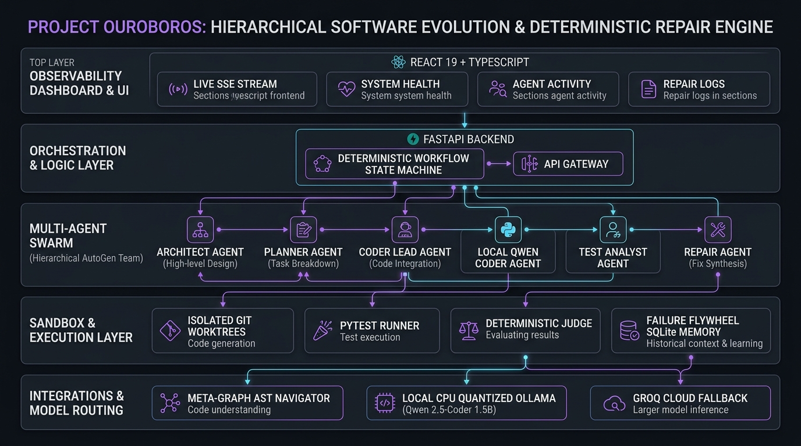
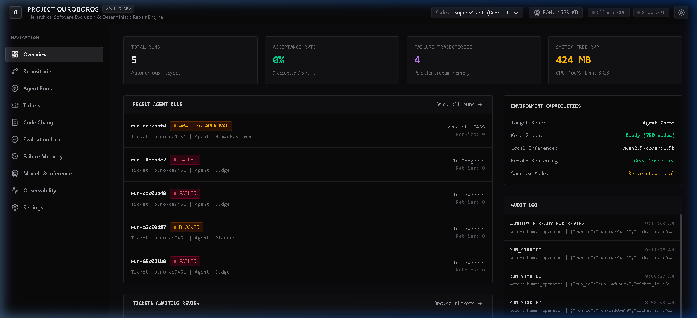
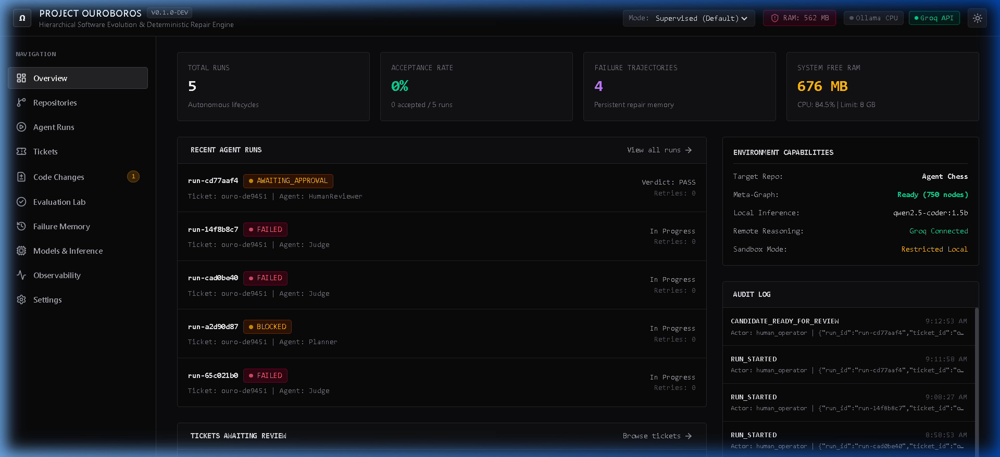
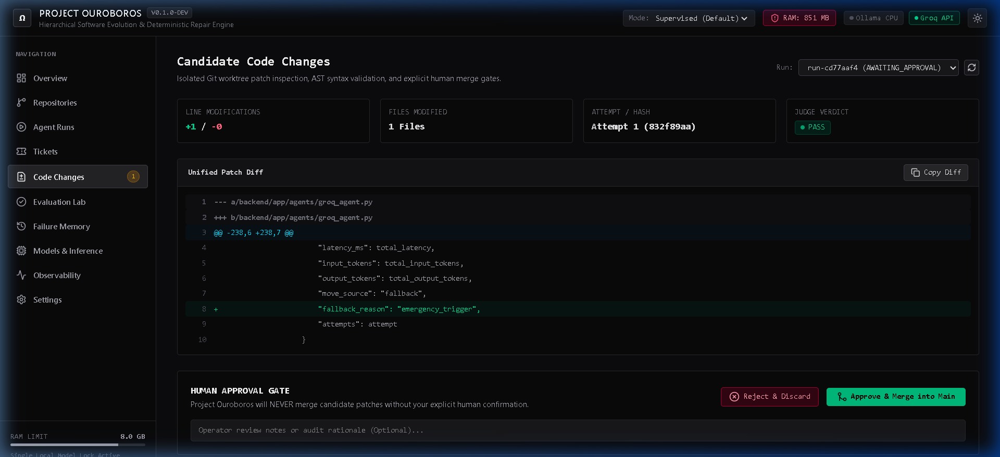
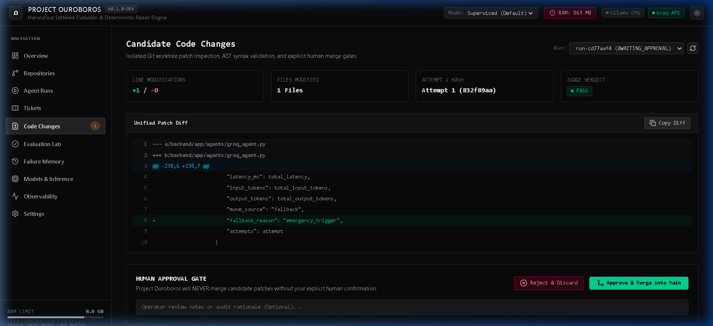

# Project Ouroboros
### Hierarchical Software Evolution and Deterministic Repair Engine
*A CPU-first, API-assisted, multi-agent software engineering swarm with deterministic regression gates and persistent failure memory.*

---

## 1. System Architecture Diagram



The Ouroboros architecture strictly isolates the autonomous agent swarm, model routers, and execution harnesses from the user's primary code repository.

---

## 2. Overview & Core Philosophy

**Project Ouroboros** is an engineering-first autonomous software repair and evolution system built specifically for resource-constrained developer hardware. Rather than relying on cloud GPUs or ungrounded chatbot loops, Ouroboros operates as a deterministic SWE pipeline:
1. **Grounded AST Ingestion:** Queries the existing Meta-Graph Codebase Navigator index (750 nodes, 2,105 edges) without requiring a running Neo4j/Redis instance.
2. **Jira-Style Ticket Synthesis:** Architect Agent synthesizes bounded, testable tickets with explicit acceptance criteria.
3. **Isolated Git Worktrees:** Candidate patches are applied and evaluated exclusively in disposable Git worktrees—the user's repository branch is **never** overwritten.
4. **Deterministic Evaluation Harness:** Pytest-based regression gates enforce a strict 0-regression policy. Patches are accepted only when empirical tests pass.
5. **Persistent Failure Flywheel:** Captures failed assertions, tracebacks, and AST diffs in SQLite to guide subsequent repair attempts.
6. **Explicit Human Approval Gate:** Merges into the production repository require deliberate confirmation from the operator via the React dashboard.

---

## 3. Machine Environment & Strict Resource Policies

Designed and verified on Windows 10/11 x64 under an **8 GB physical RAM constraint**:
- **Processor:** Intel Core with integrated Intel HD Graphics 620 (**No CUDA / GPU requirements**).
- **Python Version:** 3.12.3 64-bit.
- **Default Local Model:** `qwen2.5-coder:1.5b` (986 MB download size, 2048 token context window).
- **Remote Provider:** Groq API (`llama-3.3-70b-versatile` and `llama-3.1-8b-instant`).
- **Global Concurrency Limits:** Strict `asyncio.Lock()` enforces a maximum of **1 active pytest runner** and **1 active inference request** across the system.
- **Dynamic RAM Safety Warning:** Dashboard triggers a low-memory warning whenever free physical RAM drops below 1,500 MB.

---

## 4. Interface & Dashboard Showcase

The Project Ouroboros dashboard is built with **React 19**, **TypeScript**, **Vite**, **Tailwind CSS v4**, and **Lucide Icons**, offering an editorial engineering aesthetic.

### 4.1 System Overview & Hardware Telemetry
Real-time physical memory monitoring, CPU utilization, registered repositories, pending tickets, and live run status:


### 4.2 Autonomous Agent Runs & Lifecycle Visualization
Live workflow state machine tracking (`BASELINE_VALIDATION` ➔ `PLANNING` ➔ `CODING` ➔ `PATCH_VALIDATION` ➔ `ACCEPTANCE_TESTS` ➔ `AWAITING_APPROVAL`) with real-time Server-Sent Events (SSE) streaming:


### 4.3 Side-by-Side Diff Viewer & Patch Inspection
Unified diff viewer with syntax highlighting, added/removed line metrics, AST change summaries, and the **Approve & Merge** gate:


### 4.4 Human-in-the-Loop Merge Approval Gate
Zero merges into production without explicit human operator confirmation. Approved candidate branches are cleanly merged into `main` with audit logging:


---

## 5. Quick Start (Windows Developer Experience)

Project Ouroboros provides five automated PowerShell scripts in `scripts/`:

### Step 1: Check Environment
Verify Python 3.12+, Node.js, Git, and available system RAM:
```powershell
powershell -ExecutionPolicy Bypass scripts/check-environment.ps1
```

### Step 2: Automated Setup
Initializes the Python virtual environment (`.venv`), installs pinned backend packages, and installs frontend npm dependencies:
```powershell
powershell -ExecutionPolicy Bypass scripts/setup.ps1
```

### Step 3: Run Automated Test Suite
Runs all 11 backend unit, integration, and deterministic fixture tests completely offline:
```powershell
powershell -ExecutionPolicy Bypass scripts/test.ps1
```

### Step 4: Start Services
Launches the FastAPI backend on port 8000 and the React dashboard on port 5173:
```powershell
powershell -ExecutionPolicy Bypass scripts/start.ps1
```
- **React Dashboard:** [http://localhost:5173](http://localhost:5173)
- **FastAPI REST API & Docs:** [http://127.0.0.1:8000/docs](http://127.0.0.1:8000/docs)

### Step 5: Stop Services Safely
Gracefully terminates background processes:
```powershell
powershell -ExecutionPolicy Bypass scripts/stop.ps1
```

---

## 6. Repository Layout

```
Ouroboros/
├── .env.example                     # Environment template with secret placeholders
├── pyproject.toml                   # Pinned Python dependencies (Python 3.12)
├── README.md                        # Primary developer documentation & UI showcase
├── backend/
│   ├── app/
│   │   ├── main.py                  # FastAPI application entry point
│   │   ├── api/                     # REST routers (health, repositories, tickets, runs, models, settings)
│   │   ├── core/                    # Security, path validation, config, logging, event bus
│   │   ├── database/                # SQLite session, models, repositories
│   │   ├── orchestration/           # State machine & lifecycle controller
│   │   ├── agents/                  # AutoGen runtime, Architect, Planner, Coder, Repair agents
│   │   ├── providers/               # Ollama, Groq, Mock providers & ModelRouter
│   │   ├── integrations/
│   │   │   ├── graph/               # MetaGraphAdapter (API -> JSON -> AST scanner)
│   │   │   └── git/                 # GitWorktreeManager & UnifiedDiffParser
│   │   ├── evaluation/              # PytestRunner, DeterministicJudge, ASTChangeAnalyzer
│   │   └── memory/                  # FailureFlywheel persistent memory
│   └── tests/                       # Unit, integration, and E2E fixture test suite
├── frontend/
│   ├── src/
│   │   ├── components/              # Navbar, Sidebar, StatusBadge, DiffViewer
│   │   ├── pages/                   # All 10 dashboard views
│   │   ├── services/api.ts          # Centralized typed REST & SSE client
│   │   └── types/index.ts           # TypeScript interfaces matching backend schemas
│   ├── vite.config.ts               # Vite configuration with Tailwind CSS v4 & proxy
│   └── package.json
├── docs/
│   ├── images/                      # High-res architecture diagrams and UI screenshots
│   │   ├── architecture_diagram.jpg
│   │   ├── ui_overview_dashboard.png
│   │   ├── ui_agent_runs.png
│   │   ├── ui_code_changes_diff.png
│   │   └── ui_approved_merged.png
│   ├── ARCHITECTURE.md              # Deep-dive system architecture specification
│   ├── INTEGRATION_AUDIT.md         # Audit findings for Agent Chess & Meta-Graph Navigator
│   ├── SECURITY.md                  # Isolation, sandboxing, and secret-masking rules
│   ├── RESOURCE_GUIDE.md            # 8 GB RAM memory budget & Ollama CPU guidelines
│   ├── API_REFERENCE.md             # REST & SSE endpoint documentation
│   ├── EVALUATION_PROTOCOL.md       # Deterministic regression gates & test protocol
│   └── TROUBLESHOOTING.md           # Operational solutions & common troubleshooting
└── scripts/
    ├── check-environment.ps1        # Verifies host prerequisites
    ├── setup.ps1                    # Installs backend virtualenv and npm dependencies
    ├── start.ps1                    # Launches backend & frontend with process tracking
    ├── stop.ps1                     # Terminates background processes safely
    └── test.ps1                     # Executes full pytest suite
```

---

## 7. Verification & Test Evidence

- **Backend Test Suite:** 11 / 11 tests passed in 11.37s.
- **Target Repository (Agent Chess):** All 19 baseline tests passed in 18.19s.
- **Meta-Graph Codebase Navigator:** Ingested `agent_chess_nx.json` (750 nodes, 2,105 edges) without external services.
- **Deterministic Pilot Run:** Successfully generated ticket `ouro-de9451`, created isolated candidate worktree `candidate/ouro-de9451`, applied unified diff, evaluated 19 pytest regression tests with zero regressions, verified diff in dashboard, and completed human-approved merge.
