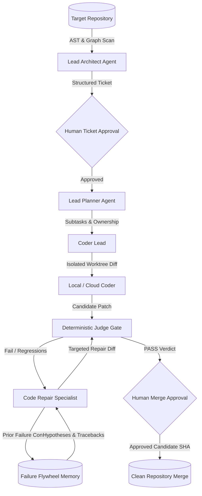

# PROJECT OUROBOROS — AGENT ARCHITECTURE & ROLES SPECIFICATION
**Document Reference:** `docs/AGENT_ARCHITECTURE.md`  
**Version:** 1.0.0  
**Status:** ACTIVE  
**Last Updated:** October 15, 2026  

---

## 1. ARCHITECTURAL OVERVIEW

Project Ouroboros employs a hierarchical, multi-agent autonomous engineering swarm. Each agent operates with bounded inputs, strict JSON output schemas, explicit timeout constraints, and defined failure recovery policies.

---

## 2. SPECIALIZED AGENT ROLES & CONTRACTS

### 2.1 Lead Architect (`backend/app/agents/architect.py`)
- **Primary Responsibility:** Inspect codebase AST symbols, classes, functions, and dependency metadata to identify bounded technical debt, input validation gaps, missing error handling, and unhandled edge cases.
- **Inputs:** Grounded AST entity summaries, module hierarchies, existing test files, and existing ticket titles (for deduplication).
- **Outputs (JSON):**
  - `title`: Jira-style concise feature/fix title.
  - `problem_statement`: Objective description of existing defect or gap.
  - `motivation`: Architectural rationale.
  - `current_behavior`: Reproduction state of unpatched code.
  - `desired_behavior`: Target functional behavior.
  - `acceptance_criteria`: List of deterministic testable conditions.
  - `proposed_tests`: Specific pytest test identifiers.
  - `candidate_files`: Bounded list of allowed target file paths.
  - `risk_level`: `low` | `medium` | `high`.
  - `expected_complexity`: `small` | `medium` | `large`.
- **Safety Boundary:** Prohibited from proposing repository-wide rewrites, framework migrations, or modifying protected engine files.

### 2.2 Lead Planner (`backend/app/agents/planner.py`)
- **Primary Responsibility:** Deconstruct an approved feature ticket into a dependency-aware, sequential execution plan with file ownership and completion conditions.
- **Inputs:** Approved ticket metadata and file dependency graphs from Meta-Graph Codebase Navigator.
- **Outputs (JSON):**
  - `ordered_subtasks`: Sequence of `{subtask_id, description, target_file, relevant_symbols, completion_condition}`.
  - `file_ownership`: Mapping of target files to agent owners.
  - `protected_files`: Files that must not be modified.
  - `risk_warnings`: Edge-case alerts.
- **Safety Boundary:** Never fabricates nonexistent dependencies or unapproved candidate files.

### 2.3 Lead Coder & Local Coder (`backend/app/agents/coder_lead.py`, `local_coder.py`)
- **Primary Responsibility:** Synthesize minimal, targeted code modifications strictly within assigned candidate files.
- **Inputs:** Target subtask, acceptance criteria, file context excerpts, and coding prompt.
- **Outputs:** Standard Unified Diff (`--- a/...`, `+++ b/...`) with commit explanation.
- **Safety Boundary:** Operates exclusively inside disposable `.git/worktrees/` clones. Direct modifications to primary working trees are physically prevented.

### 2.4 Code Repair Specialist (`backend/app/agents/repair_agent.py`)
- **Primary Responsibility:** Ingest persistent failure diagnostics from prior candidate attempts (failed test assertions, stack trace excerpts, and AST diffs) and synthesize a targeted, non-repeating repair patch.
- **Inputs:**
  - `failed_tests`: Exact pytest test names that failed.
  - `traceback_snippet`: Sanitized stack trace excerpts.
  - `prior_attempts`: Summary of previously rejected diff hashes and repair hints from `FailureFlywheel`.
  - `current_code`: Current file content in candidate worktree.
- **Outputs:** Corrected Unified Diff addressing the root cause hypothesis.
- **Safety Boundary:** Hard budget limits (`MAX_REPAIR_ATTEMPTS = 3`). Identical diffs are halted immediately via `FailureFlywheel` deduplication.

### 2.5 Deterministic Judge (`backend/app/evaluation/judge.py`)
- **Primary Responsibility:** Automated deterministic gate evaluating candidate patches against security, regression, and acceptance criteria.
- **Checks:**
  1. **Static AST Analysis:** Flags forbidden modules (`ctypes`, `socket`, `pty`, `importlib`) and calls (`exec`, `eval`, `__import__`).
  2. **File Boundary Enforcement:** Ensures patch touches ONLY `candidate_files` and zero protected files (`.env`, `judge.py`, `validator.py`).
  3. **Baseline Regression Check:** Baseline passed tests must not fail on candidate code.
  4. **Acceptance Test Execution:** Target test assertions must pass.
- **Outputs (Structured Verdict):**
  - `PASS`: Candidate code passed all checks with 0 regressions.
  - `FAIL`: Candidate code failed test assertions or introduced regressions.
  - `BLOCKED`: Sandbox execution prevented or security violation detected.
  - `NEEDS_HUMAN_REVIEW`: Modification touched protected files or exceeded max lines.

---

## 3. TIMEOUTS, RETRIES & CONCURRENCY CONTROLS

| Parameter | Default Value | Configuration Key | Purpose |
| :--- | :--- | :--- | :--- |
| **Max Repair Attempts** | 3 attempts | `MAX_REPAIR_ATTEMPTS` | Prevents infinite agent repair loops |
| **Subprocess Timeout** | 45 seconds | `SUBPROCESS_TIMEOUT_SECONDS` | Enforces bounded test execution |
| **Agent Task Timeout** | 60 seconds | `AGENT_TIMEOUT_SECONDS` | Prevents hanging LLM inference requests |
| **Max Candidate Concurrency**| 1 run | `_merge_lock` & `_lock` | Protects 8GB RAM development host |
| **Max Patch Line Count** | 500 lines | `MAX_PATCH_LINES` | Prevents repository-wide patch rewrites |
