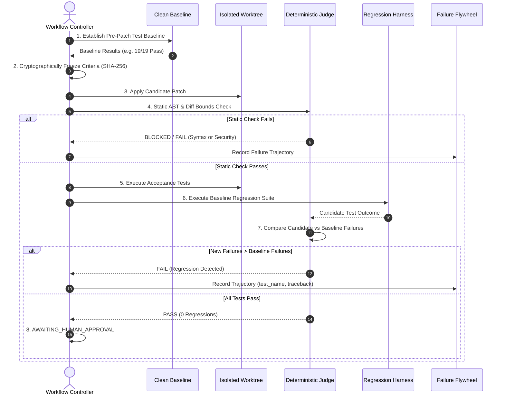

# PROJECT OUROBOROS: EVALUATION & BENCHMARKING PROTOCOL
**Document Version:** 1.0.0 (Production Hardening)  
**Classification:** Research & Empirical Evaluation Standard  
**Status:** ACTIVE  

---

## 1. Evaluation Philosophy

In automated code generation, an agent's claim that *"the code is complete and correct"* has zero evidential value. Generated unit tests created by the same model that synthesized the patch cannot serve as independent proof of correctness.

Project Ouroboros enforces a **Deterministic Evaluation Protocol** where code correctness is decided exclusively by deterministic software gates, independent test runners, and baseline comparison.

---

## 2. The 12-Stage Evaluation Pipeline



---

## 3. Strict Verdict Taxonomy

The Deterministic Judge returns exactly one of five explicit verdicts:

| Verdict | Meaning | Merge Permitted? |
| :--- | :--- | :---: |
| **`PASS`** | All static AST checks, acceptance tests, and baseline regression suites passed with **0 newly introduced regressions**. | Yes (Requires Human Approval) |
| **`PASS_WITH_WARNINGS`** | All functional tests passed, but minor non-blocking style/lint warnings were flagged. | Yes (Requires Human Review) |
| **`FAIL`** | One or more acceptance tests failed, or candidate test failure count exceeded baseline. | No (Routes to Repair Agent) |
| **`BLOCKED`** | Patch violates security boundaries, touches forbidden files, contains syntax errors, or sandbox is offline in fail-closed mode. | No (Execution Halted) |
| **`NEEDS_HUMAN_REVIEW`** | Ambiguous behavior detected (e.g. baseline had pre-existing failures matching candidate failure counts). | No (Requires Operator Decision) |

---

## 4. Regression Isolation: Baseline vs. Candidate

To prevent pre-existing repository bugs from blocking new patches, the Judge calculates:
$$\text{New Regressions} = \text{Failures}_{\text{candidate}} \setminus \text{Failures}_{\text{baseline}}$$

* Pre-existing defects are cataloged as `KNOWN_BASELINE_DEFECTS`.
* A patch is marked as a regression **only if** $\text{Count}(\text{Failures}_{\text{candidate}}) > \text{Count}(\text{Failures}_{\text{baseline}})$.
* Conversely, an existing failure never excuses a newly introduced bug.

---

## 5. Machine-Readable Evaluation Report Schema

Every evaluation produces a persistent JSON report:
```json
{
  "run_id": "run-40ee7c04",
  "ticket_id": "ouro-3a6996",
  "base_commit": "c7dedd8902e5c845c0fe8a6767f58312add1db3d",
  "candidate_patch_hash": "61dbf593a05786a347b74...",
  "frozen_criteria_hash": "a4f89d0e123...",
  "verdict": "PASS",
  "baseline_summary": {"passed": 19, "failed": 0, "duration_ms": 12130},
  "candidate_summary": {"passed": 20, "failed": 0, "duration_ms": 12450},
  "regressions_detected": [],
  "security_findings": [],
  "timestamp": "2026-10-15T14:28:10Z"
}
```
