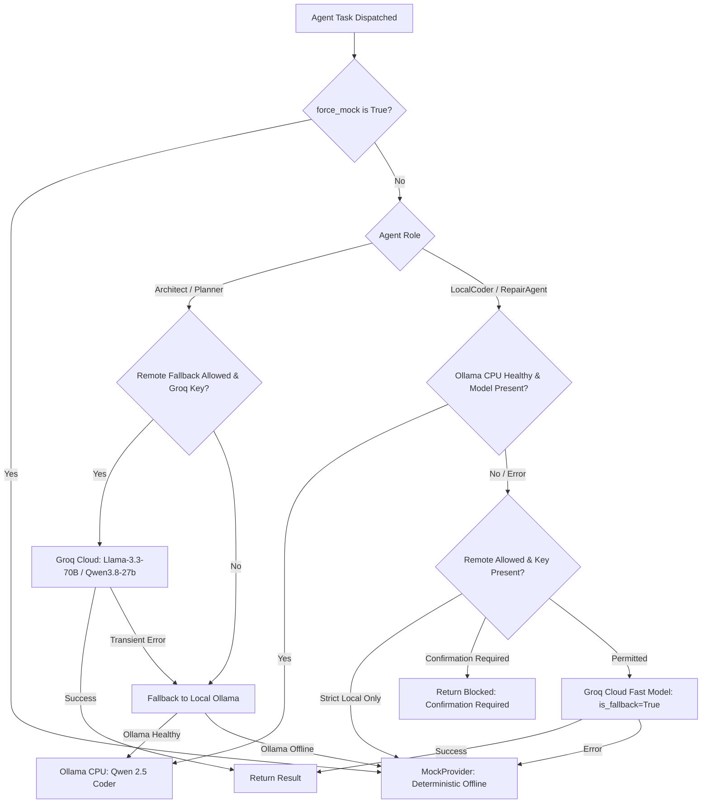

# PROJECT OUROBOROS — MODEL ROUTING & PRIVACY SPECIFICATION
**Document Reference:** `docs/MODEL_ROUTING_AND_PRIVACY.md`
**Classification:** Architecture, Governance & Data Privacy Standard
**Version:** 1.0.0
**Status:** ACTIVE
**Last Updated:** October 15, 2026

---

## 1. Executive Summary & Core Principles

Project Ouroboros employs a multi-tiered, capability-aware model routing and privacy architecture designed to operate safely on resource-constrained hardware (Windows 10 x64, 8 GB RAM, CPU-first inference) while preventing proprietary code or secret leakage.

### Core Architectural Invariants:
1. **Deterministic Authority:** Security decisions, file access boundaries, diff validation, test pass/fail results, and merge authorizations are strictly governed by deterministic Python backend code (`DeterministicJudge`, `UnifiedDiffParser`, `SandboxDetector`). LLM outputs are **strictly advisory** and never have the final security authority.
2. **Explicit Consent for Remote Inference:** Code and issue context are never dispatched to external cloud APIs (e.g., Groq) unless the operator has explicitly configured `ALLOW_REMOTE_FALLBACK=True` and `STRICT_LOCAL_ONLY=False`.
3. **Fail-Closed Privacy Boundary:** If local inference engines (Ollama) are unavailable and remote fallback is disabled or unauthorized, the system gracefully enters `MockProvider` or halts with a structured `BLOCKED` reason code. It **never** silently switches to remote providers.
4. **Zero Credential Exfiltration:** Sensitive files (`.env`, `id_rsa`, `id_ed25519`, certificates), API keys, and environment variables are scrubbed by `mask_secret()` before prompt formatting or telemetry emission.
5. **Memory & Concurrency Bounds:** Respects the 8 GB host RAM ceiling by serializing model inference to a single concurrent task and utilizing quantized CPU weights (e.g., Qwen 2.5 Coder 1.5B/7B Q4_K_M).

---

## 2. Agent Roles, Schemas & Authority Matrix

```
+------------------------------------------------------------------------------------------------------------------+
|                                        AGENT ROLE ARCHITECTURAL MATRIX                                           |
+-------------------+----------------------------+-----------------------+--------------------+--------------------+
| Role              | Input Schema               | Output Schema         | Inference Tier     | Security Authority |
+-------------------+----------------------------+-----------------------+--------------------+--------------------+
| 1. Architect      | Repo AST + Discovery Context| Structured Ticket JSON| Groq/Ollama/Mock   | Advisory Only      |
| 2. Planner        | Approved Ticket Schema     | Subtask DAG JSON      | Groq/Ollama/Mock   | Advisory Only      |
| 3. Local Coder    | Subtask + Target Context   | Unified Diff Text     | Ollama CPU / Mock  | Advisory Only      |
| 4. Repair Agent   | Failure Trace + Prior Diffs| Corrective Diff Text  | Ollama CPU / Groq  | Advisory Only      |
| 5. Critic         | Candidate Diff + Test Logs | Quality Assessment    | Groq/Ollama/Mock   | Advisory Only      |
| 6. Judge (Engine) | Patch + AST + Test Harness | Structured Verdict    | Deterministic Core | Authoritative Gate |
+-------------------+----------------------------+-----------------------+--------------------+--------------------+
```

### 2.1 Lead Architect
* **Input Schema:** `RepoSummary` (AST metadata, module list, public symbols, test file inventory).
* **Output Schema:** `TicketProposal` (`title`, `problem_statement`, `motivation`, `current_behavior`, `desired_behavior`, `acceptance_criteria_json`, `candidate_files_json`).
* **Responsibilities:** Analyzes code smells, dependency rot, or bug reports; proposes well-scoped, testable repair tickets.
* **Non-Responsibilities:** Writing patches, executing tests, approving tickets, or authoring git commits.
* **Timeout & Retries:** 45 seconds timeout; maximum 2 retries on malformed JSON with schema self-correction.
* **Authority:** Advisory. The ticket requires explicit operator approval before entering `PLANNING` or `CODING`.

### 2.2 Lead Planner
* **Input Schema:** Approved `Ticket` object.
* **Output Schema:** `ExecutionPlan` (`subtasks`: list of `{id, description, target_file, verification_step}`).
* **Responsibilities:** Breaks complex tickets into ordered, bounded subtasks; identifies required test suites.
* **Non-Responsibilities:** Modifying code or executing subprocesses.
* **Timeout & Retries:** 30 seconds timeout; 1 retry.
* **Authority:** Advisory.

### 2.3 Local Coder
* **Input Schema:** `PlanSubtask` + bounded target file content (maximum 300 lines of context).
* **Output Schema:** Unified diff string conforming to `--- a/...` and `+++ b/...` format.
* **Responsibilities:** Synthesizes minimal, targeted bug fixes and passes them to the worktree manager.
* **Non-Responsibilities:** Modifying protected engine files, running git commands directly, or making network calls.
* **Token Budget:** Maximum 2,048 completion tokens; prompt context capped at 4,096 tokens.
* **Authority:** Advisory. The patch must pass AST validation, boundary inspection, and isolated sandbox tests.

### 2.4 Repair Agent (Flywheel)
* **Input Schema:** Prior candidate patch, test failure excerpt (last 30 lines of traceback), and retrieved failure memories.
* **Output Schema:** Corrective unified diff addressing the exact failure cause.
* **Responsibilities:** Inspects prior failure trajectory, avoids repeat failure patterns, and attempts targeted remediation within budget (default: 3 repair attempts).
* **Non-Responsibilities:** Bypassing tests, altering test fixtures to force a pass, or modifying engine configuration.
* **Authority:** Advisory. Evaluated under the identical deterministic test harness.

### 2.5 Deterministic Judge (Security & Correctness Authority)
* **Implementation:** Pure Python application logic (`DeterministicJudge` in `backend/app/evaluation/judge.py`).
* **Inputs:** Unified diff text, worktree path, allowed files list, and test suite definitions.
* **Verification Steps:**
  1. **Diff Syntax Check:** Confirms unified diff header format; rejects malformed or truncated hunks.
  2. **Boundary Gate:** Rejects out-of-scope files (`candidate_files_json`) and modifications exceeding 500 lines.
  3. **Protected Path Gate:** Blocks any diff touching `.env`, `.git`, `.github/workflows`, `judge.py`, `runner.py`, `security.py`, `docker.sock`, or private keys.
  4. **Static AST Analysis:** Inspects syntax validity and rejects prohibited primitives (`os.system`, `subprocess`, `socket`, `ctypes`, `eval`, `exec`).
  5. **Sandbox Pytest Evaluation:** Executes target acceptance and regression tests inside the isolated container or fail-closed runner.
* **Verdicts:** `PASS`, `PASS_WITH_WARNINGS`, `FAIL`, `BLOCKED`, `NEEDS_HUMAN_REVIEW`.
* **Authority:** **Absolute Security Authority**. No candidate patch can enter review or merge without passing this gate.

---

## 3. Provider Routing & Fallback Policy



### 3.1 Routing Configuration Variables (`.env`)
* `ALLOW_REMOTE_FALLBACK` (`bool`, default: `True`): Governs whether cloud API fallbacks are permitted.
* `STRICT_LOCAL_ONLY` (`bool`, default: `False`): Air-gapped mode. Completely disables any outgoing HTTP request to cloud LLM endpoints.
* `REQUIRE_FALLBACK_CONFIRMATION` (`bool`, default: `False`): If enabled, pauses workflow when local models fail, requesting explicit user approval before routing to Groq.
* `GROQ_API_KEY` (`str`, optional): Cloud provider credential.
* `GROQ_REASONING_MODEL` (`str`, default: `llama-3.3-70b-versatile`).
* `GROQ_FAST_MODEL` (`str`, default: `llama-3.1-8b-instant`).
* `LOCAL_MODEL_NAME` (`str`, default: `qwen2.5-coder:1.5b-base-q4_K_M`).
* `OLLAMA_BASE_URL` (`str`, default: `http://localhost:11434`).

---

## 4. Hardware Safety & Resource Governance (8 GB RAM Constraint)

1. **Serialized Inference Execution:**
   - LLM generation runs with global serialization lock. Only one model inference task executes at any given millisecond.
2. **Quantized Footprint:**
   - Recommended local weights: 1.5B to 7B parameters quantized to 4-bit (Q4_K_M), requiring ≤ 1.8 GB RAM.
3. **RAM Guardrail (`check_memory_threshold`):**
   - Before launching intensive local inference, the system queries available physical memory.
   - If available RAM < 1,500 MB, a telemetry warning is emitted, and the system prompts the operator or falls back cleanly rather than thrashing virtual memory.
4. **No Automatic Model Downloads:**
   - The platform never initiates multi-gigabyte model downloads automatically without explicit user interaction in the CLI/settings.

---

## 5. Telemetry, Tracing & Data Scrubbing Standards

1. **Arize Phoenix / OpenTelemetry Local Isolation:**
   - Phoenix traces are exported exclusively to loopback (`http://127.0.0.1:6006`).
   - If Phoenix is offline, the exporter silently drops spans after bounded retries, preventing workflow lockups or host crashes.
2. **Secret Redaction (`mask_secret`):**
   - API keys matching `gsk_[A-Za-z0-9]{20,}` or standard password patterns are masked to `****...****`.
3. **Prompt Stripping (`PHOENIX_CAPTURE_PROMPTS`):**
   - In production configurations, raw prompts and model completion texts are omitted from span attributes, preserving only token metrics, latencies, and function call names.
