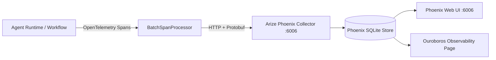

# PROJECT OUROBOROS — ARIZE PHOENIX OBSERVABILITY SPECIFICATION
**Document Reference:** `docs/PHOENIX_OBSERVABILITY.md`  
**Observability Engine:** Arize Phoenix OpenTelemetry Tracer (`backend/app/observability/phoenix_service.py`)  
**Collector Endpoint:** `http://127.0.0.1:6006/v1/traces`  
**Project Name:** `ouroboros-swarm`  
**Status:** ACTIVE  
**Last Updated:** October 15, 2026  

---

## 1. OBSERVABILITY ARCHITECTURE

Project Ouroboros integrates OpenTelemetry tracing via Arize Phoenix to provide full operational visibility into multi-agent workflows, prompt durations, token usage, tool invocations, and test evaluation latencies.

---

## 2. INSTRUMENTED STAGES & SPANS

Every autonomous workflow lifecycle emits structured spans:

| Span Identifier | Component | Captured Attributes |
| :--- | :--- | :--- |
| `Architect.AnalyzeRepository` | Lead Architect | `repo_id`, `file_count`, `identified_debt_count` |
| `Planner.CreatePlan` | Lead Planner | `ticket_id`, `subtask_count`, `target_files` |
| `Coder.GeneratePatch` | Local / Cloud Coder | `model`, `provider`, `prompt_tokens`, `completion_tokens`, `diff_lines` |
| `Judge.EvaluatePatchStatic` | Deterministic Judge | `ast_violations`, `protected_files_checked`, `verdict` |
| `Evaluator.RunTestHarness` | Pytest Runner | `command`, `working_dir`, `exit_code`, `passed_count`, `failed_count`, `duration_ms` |
| `Repair.SynthesizeRepair` | Repair Agent | `attempt`, `prior_rejections_count`, `repaired_diff_hash` |
| `Merge.CommitAndMerge` | Git Worktree Manager | `candidate_sha`, `branch`, `merge_commit_sha` |

---

## 3. SECURITY & PRIVACY CONTROLS

1. **Zero Raw Secret Telemetry:** All API keys matching `gsk_[A-Za-z0-9_-]+` or `bearer\s+[A-Za-z0-9_\-\.]+` are masked to `gsk_...Uctb` before span serialization.
2. **Offline Resilience:** If the Phoenix server is not running on port 6006, the `BatchSpanProcessor` catches network errors silently without interrupting code repair or test execution.
3. **Opt-in Cloud Export:** By default, all telemetry remains 100% on `localhost:6006`. External cloud export is disabled unless explicitly enabled in configuration.
