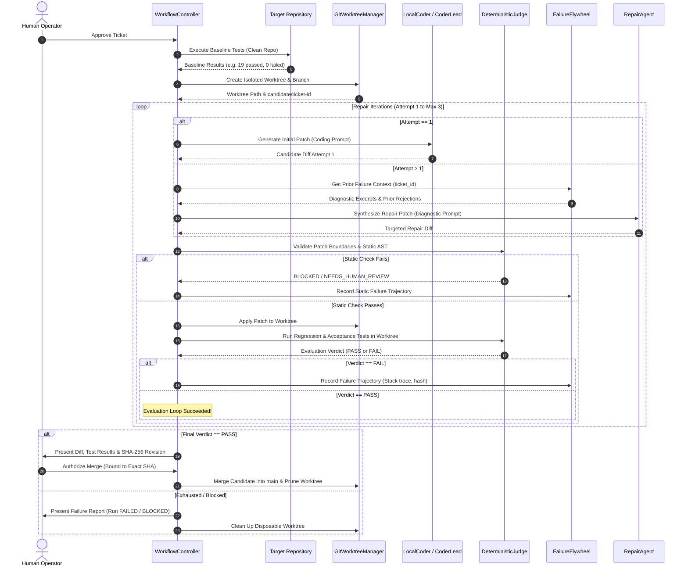

# PROJECT OUROBOROS — MULTI-AGENT REPAIR LIFECYCLE
**Document Reference:** `docs/REPAIR_LIFECYCLE.md`  
**Version:** 1.0.0  
**Status:** ACTIVE  
**Last Updated:** October 15, 2026  

---

## 1. REPAIR LIFECYCLE OVERVIEW

The Ouroboros repair lifecycle is a closed-loop, deterministic self-healing cycle designed to prevent regression, detect repeated failure loops, and enforce strict human approval boundaries.

---

## 2. KEY LIFECYCLE MECHANISMS

### 2.1 Baseline Differentiation
Before any candidate code is generated or executed, `WorkflowController` runs baseline tests against the clean, unpatched target repository:
- **Baseline Failures:** Pre-existing broken tests are recorded. The candidate is NOT penalized for failures that existed before its creation.
- **Candidate Regressions:** If any test that passed during baseline evaluation fails during candidate evaluation, the DeterministicJudge immediately delivers a `FAIL` verdict with tag `REGRESSION_DETECTED`.

### 2.2 Persistent Failure Trajectory Flywheel
When candidate evaluation fails:
1. `FailureFlywheel.record_failure()` captures:
   - `ticket_id`, `run_id`, `attempt` number.
   - `failed_tests`: Exact failed test method names.
   - `traceback_excerpt`: Sanitized 2,000-character traceback.
   - `patch_hash`: SHA-256 hash of the rejected diff.
   - `root_cause_hypothesis` and `repair_hint`.
2. **Repetition Detection:** If an identical patch hash and test failure tuple is generated again, the flywheel tags the status as `REPEATED` and aborts further identical loops.
3. **Context-Bounded Retrieval:** `get_repair_context(ticket_id, max_history=3)` supplies the Repair Agent with prior failed assertions and hints, preventing repetitive failures.

### 2.3 Strict Reversal & Working Tree Protection
- All modifications occur in `.git/worktrees/<ticket-id>/` on a dedicated branch `candidate/<ticket-id>`.
- The developer's primary working tree remains untouched throughout the cycle.
- Worktrees are pruned safely on success, failure, cancellation, or conflict.
