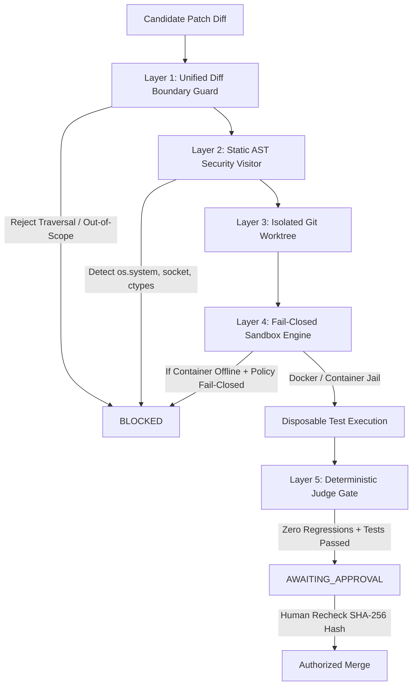

# PROJECT OUROBOROS: SECURITY MODEL & EXECUTION GUARDRAILS
**Document Version:** 1.0.0 (Production Hardening)  
**Classification:** Defensive Engineering Specification  
**Status:** ACTIVE  

---

## 1. Threat Model & Trust Assumptions

Project Ouroboros accepts and evaluates AI-generated code changes, third-party repositories, test suites, and external LLM responses. In accordance with zero-trust DevSecOps principles, **all candidate code, generated diffs, AST structures, test fixtures, and repository files are treated as untrusted data.**

### 1.1 Threat Actors & Vectors
* **Malicious or Hallucinated Patch Payloads:** LLMs generating destructive file operations (`shutil.rmtree`), arbitrary shell executions (`os.system`, `subprocess.Popen`), or network exfiltration hooks (`socket.connect`).
* **Path Traversal & Symlink Attacks:** Diffs attempting to write outside the candidate worktree root via relative paths (`../../`) or symlinked target directories.
* **Secret & Credential Exfiltration:** Untrusted code reading `.env`, `id_rsa`, `credentials.json`, or environment variables containing API keys.
* **Test Fixture Abuse:** Tests designed to bypass verification by deleting assertion logic or mutating frozen acceptance criteria.
* **Denial of Service (DoS):** Infinite repair loops, memory exhaustion, unbounded subprocess spawning, or excessive API token consumption.

---

## 2. Layered Defense Architecture

---

## 3. Security Boundary Controls

### 3.1 Path Traversal & Symlink Enforcement
Implemented in `backend/app/core/security.py` via `validate_safe_path`:
* All target paths must resolve strictly as children of the repository root (`relative_to` check).
* System secret files (`.env`, `.env.local`, `.pem`, `id_rsa`, `id_ed25519`) are blocked from write or read access.
* Direct writes to the `.git` directory are strictly prohibited.

### 3.2 AST Static Security Analysis
Implemented in `backend/app/sandbox/security.py` via `ASTSecurityVisitor`:
* **Prohibited Primitives:** `os.system`, `os.popen`, `os.spawn`, `os.exec*`, `subprocess.Popen`, `subprocess.run`, `subprocess.call`, `eval`, `exec`, `__import__`, `compile`.
* **Prohibited Imports:** `socket`, `ctypes`, `pty`.
* Violation immediately results in a `BLOCKED` verdict before any test runner is invoked.

### 3.3 Ephemeral Git Worktree Isolation
Implemented in `backend/app/integrations/git/worktree.py`:
* The developer's primary working tree is **never touched**.
* Patches are applied to disposable branches (`candidate/ouro-...`) inside `worktrees/ouro-...`.
* Unsuccessful, rejected, or cancelled runs are pruned automatically.

### 3.4 Execution Sandboxing & Fail-Closed Policy
* **Preferred Runtime:** Disposable rootless Docker container with non-root UID, read-only base volume, 0 network access, and bounded CPU/RAM cgroups.
* **Fail-Closed Mode (`REQUIRE_CONTAINER_SANDBOX=True`):** If the Docker daemon is offline or inaccessible, the system refuses to execute code and marks the run `BLOCKED`.
* **Restricted Local Mode:** Only permitted in local development with prominent UI warnings and bounded subprocess timeouts (`SUBPROCESS_TIMEOUT_SECONDS=60`).

---

## 4. Cryptographic Review Binding & Merging Safeguards

1. **Frozen Acceptance Criteria:** Acceptance criteria and proposed test specs are hashed (`SHA-256`) when the ticket is approved. Any alteration invalidates the run.
2. **Hash-Bound Merges:** Merges require the operator to approve the exact candidate SHA-256 hash. If candidate files drift or a secondary patch is applied, the approval is immediately invalidated (`HTTP 409 Conflict`).
3. **No Autonomous Production Merges:** Human operator review is mandatory by default (`AUTONOMY_MODE=SUPERVISED`).
