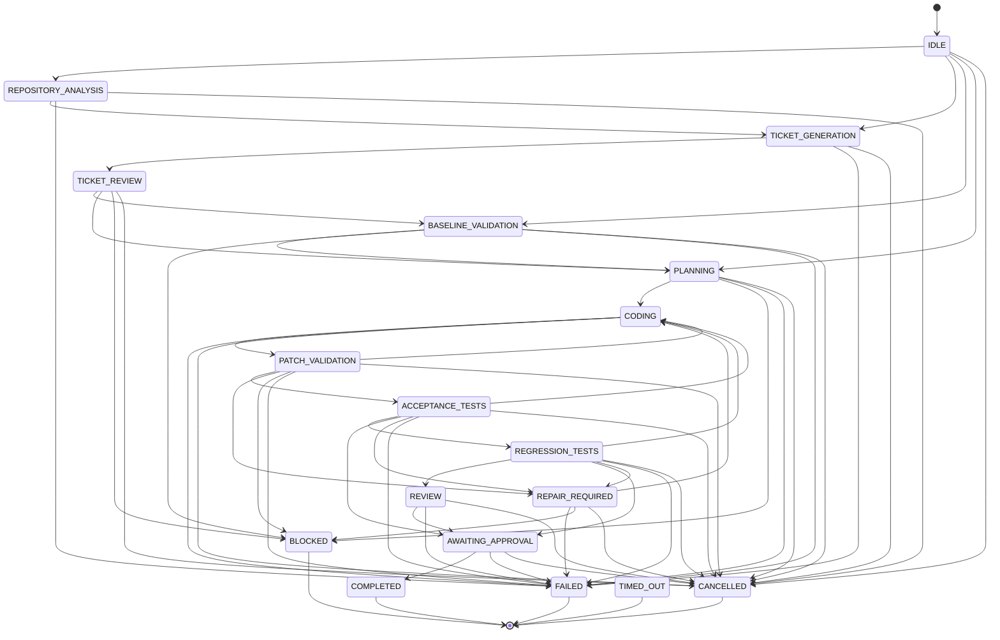

# PROJECT OUROBOROS — WORKFLOW STATE MACHINE SPECIFICATION
**Document Reference:** `docs/WORKFLOW_STATE_MACHINE.md`  
**Version:** 1.0.0  
**Status:** ACTIVE  
**Last Updated:** October 15, 2026  

---

## 1. STATE MACHINE PRINCIPLES

1. **Deterministic Authority:** The state machine is governed strictly by hardcoded Python logic (`backend/app/orchestration/state_machine.py`), never by LLM output.
2. **Terminal Invariance:** Terminal states (`COMPLETED`, `FAILED`, `BLOCKED`, `CANCELLED`, `TIMED_OUT`) have zero outgoing transitions. Once a run enters a terminal state, it cannot transition further.
3. **Fail-Closed Routing:** Any unhandled exception, security violation, or missing container runtime immediately transitions the run to `BLOCKED` or `FAILED`.

---

## 2. STATE DEFINITIONS

| State Name | Classification | Description |
| :--- | :--- | :--- |
| `IDLE` | Initial | Initial unstarted state before workflow pipeline begins. |
| `REPOSITORY_ANALYSIS` | Discovery | Pure AST scanning of repository structure, modules, and tests. |
| `TICKET_GENERATION` | Proposal | Lead Architect proposes structured, evidence-backed Jira-style ticket. |
| `TICKET_REVIEW` | Human Gate | Ticket is presented for human inspection and approval. |
| `BASELINE_VALIDATION`| Verification | Baseline test suite executed against clean, unpatched target repository. |
| `PLANNING` | Deconstruction | Lead Planner converts approved ticket into ordered subtasks. |
| `CODING` | Generation | Local Coder / Lead Coder synthesizes candidate diff inside worktree. |
| `PATCH_VALIDATION` | Static Gate | AST check and path boundary check verify diff safety. |
| `ACCEPTANCE_TESTS` | Evaluation | Target acceptance test assertions evaluated against candidate code. |
| `REGRESSION_TESTS` | Evaluation | Full baseline test suite evaluated against candidate code to catch regressions. |
| `REPAIR_REQUIRED` | Recovery | Candidate failed evaluation; failure trajectory dispatched to Repair Agent. |
| `REVIEW` | Review | Candidate patch and evaluation summary formatted for review. |
| `AWAITING_APPROVAL` | Human Gate | Passing candidate revision hash frozen; awaiting human merge authorization. |
| `COMPLETED` | Terminal | Human approved merge; candidate cleanly integrated into repository. |
| `FAILED` | Terminal | Run terminated due to exhausted retries, unrecoverable test failures, or crash. |
| `BLOCKED` | Terminal | Run prevented by security violation, missing sandbox, or policy rejection. |
| `CANCELLED` | Terminal | Run explicitly halted by human operator. |
| `TIMED_OUT` | Terminal | Subprocess or agent task exceeded configured execution budget. |

---

## 3. STATE TRANSITION GRAPH

